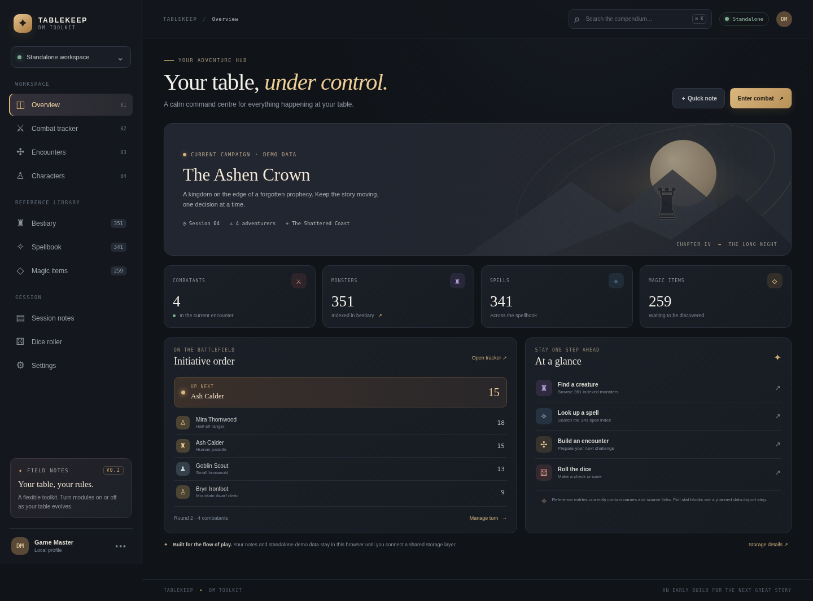

# Tablekeep — Owlbear DM Toolkit

**UI prototype v0.2.0** · Static HTML/CSS/JavaScript · No build step required.



A modular D&D table companion UI designed to run in two places:

1. **Standalone website** — deploy to GitHub Pages and open it in any modern browser.
2. **Owlbear Rodeo extension** — the same UI is embedded in an Owlbear extension action through `manifest.json` and connects to the Owlbear SDK when running inside a room.

This is an early UI prototype. It deliberately separates the presentation layer from the data layer so modules can be enabled, replaced, or removed later without rebuilding the whole app.

## Current modules

- Overview dashboard
- Combat tracker: initiative order, rounds, HP controls, conditions, manual combatants
- Owlbear token sync: imports Character-layer scene tokens and stores initiative/HP/AC/conditions in namespaced token metadata
- Bestiary index: 351 creature names and source links
- Spellbook index: 341 spell names and source links
- Magic item index: 259 item names and source links
- Character roster: create and edit simple local character cards
- Encounter forge: build and save local encounters from the monster index
- Session notes: auto-save to browser local storage
- Dice roller: expressions such as `2d20+3`, with local roll history
- Settings and local-data export

The current interface is the first working shell, not a finished rules engine. It is intentionally small enough to open in Owlbear’s action popover and in a normal browser. More specialist modules (full character builder, classes/subclasses, feats, equipment, conditions reference, travel/rest, timers, and encounter balancing) are planned as separate screens so they can be added or removed without replacing the core workspace.

## Data status

The three catalog JSON files were generated from the first user-supplied Scrapling crawl of public play5e catalogue pages. They contain **names and source URLs only**. They do not contain complete stat blocks, spell descriptions, item properties, CR, AC, HP, damage, class features, or rules text. The UI does not invent these missing values; it links back to the source page and labels those details as not imported yet.

Do not add copyrighted source text, images, licensed book content, login-only content, or material you do not have rights to distribute to a public repository. Before publishing the catalog data publicly, check the terms and licensing that apply to each source.

## Create a new GitHub repository

Suggested new repository name: `owlbear-dm-toolkit-ui` (you can choose another name; the workflow resolves the Pages URL from the repository automatically).

1. Create a new GitHub repository.
2. For the simplest free GitHub Pages setup, make this **Public**. The UI contains no secrets; keep the separate Scrapling crawler repository private if you prefer.
3. Upload the contents of this project to the repository root. Make sure the `.github/workflows/pages.yml` file is included.
4. Use branch name `main`.
5. Open **Settings → Pages** and set **Build and deployment → Source** to **GitHub Actions**.
6. Open **Actions → Deploy Tablekeep to GitHub Pages → Run workflow**. It will also deploy automatically on every push to `main`.
7. When the workflow succeeds, GitHub will show the public site URL in the deployment summary.

The workflow creates a clean `_site` folder and replaces the manifest URL template with the actual `https://OWNER.github.io/REPOSITORY/` address. You do not need to edit the manifest manually for GitHub Pages.

## Install in Owlbear Rodeo

1. Deploy the project to GitHub Pages using the steps above.
2. Copy the deployed manifest URL:

   `https://YOUR-USERNAME.github.io/YOUR-REPOSITORY/manifest.json`

3. In Owlbear Rodeo, open your profile and choose **Add Extension**.
4. Paste the manifest URL.
5. Create or open a room and enable **Tablekeep — DM Toolkit** for that room.
6. Open the extension action in the room.
7. In **Combat tracker**, choose **Sync Owlbear tokens** to import Character-layer tokens.

The first time the extension is opened, it dynamically loads the official Owlbear SDK module from `esm.sh`. An internet connection is required for that integration. If SDK loading fails, the interface remains available in local fallback mode.

Official integration references:

- https://docs.owlbear.rodeo/extensions/getting-started/
- https://docs.owlbear.rodeo/extensions/reference/manifest/
- https://docs.owlbear.rodeo/extensions/apis/room/
- https://docs.owlbear.rodeo/extensions/apis/scene/items/

## Run locally on Windows

You do not need Node.js for this static prototype.

1. Extract the ZIP.
2. Open the project folder in File Explorer.
3. Click the address bar, type `cmd`, and press Enter.
4. Run:

   ```powershell
   py -m http.server 8000
   ```

5. Open `http://localhost:8000` in your browser for standalone mode.
6. Keep the terminal open while testing.

To test the extension inside Owlbear locally, the manifest URL must point to localhost. Create a temporary local manifest with:

```json
{
  "name": "Tablekeep — DM Toolkit (Local)",
  "version": "0.1.0",
  "manifest_version": 1,
  "action": {
    "title": "Tablekeep Local",
    "icon": "http://localhost:8000/icon.svg",
    "popover": "http://localhost:8000/index.html?mode=owlbear",
    "width": 760,
    "height": 760
  }
}
```

Save it as `manifest.local.json`, then use `http://localhost:8000/manifest.local.json` as the extension URL. Owlbear's own hello-world guide uses the same localhost workflow: https://docs.owlbear.rodeo/extensions/tutorial-hello-world/install-your-extension/

## Storage and sync notes

- Standalone mode stores demo combat, characters, encounters, notes, and dice history in the current browser's `localStorage`.
- Owlbear mode stores the encounter turn order in room metadata and per-token combat values in namespaced token metadata (`com.tablekeep.dnd-toolkit/*`).
- Owlbear room metadata is intended for small values and has a 16 KB total limit. The app only writes compact initiative/turn-order data there; it does not put the bestiary or other catalog data in room metadata.
- The bestiary, spells, and item catalog are static JSON files served with the website. They are not synchronized room state.
- The current sync imports tokens and their stored metadata. Full player sheet sync, campaign cloud storage, permissions UX, and multi-campaign database are future work.

## Project structure

```text
.
├── .github/workflows/pages.yml
├── css/app.css
├── data/
│   ├── index_manifest.json
│   ├── magic_items.json
│   ├── monsters.json
│   └── spells.json
├── icon.svg
├── index.html
├── js/app.js
├── manifest.json
└── README.md
```

## Development roadmap

1. Import full monster, spell, and item detail records from datasets we are allowed to use.
2. Expand character creation and sheet rules.
3. Improve Owlbear sync with permissions, selected-token workflows, and conflict-safe updates.
4. Add encounter difficulty calculations and saving/export.
5. Add feature flags so nonessential modules can be removed from the build.

## License

The original Tablekeep interface code in this repository is provided under the MIT License. The bundled index JSON files are derived from a user-supplied crawl of public source catalogues and are not a grant of rights to redistribute underlying source content. See `THIRD_PARTY_NOTICES.md` before redistribution.
